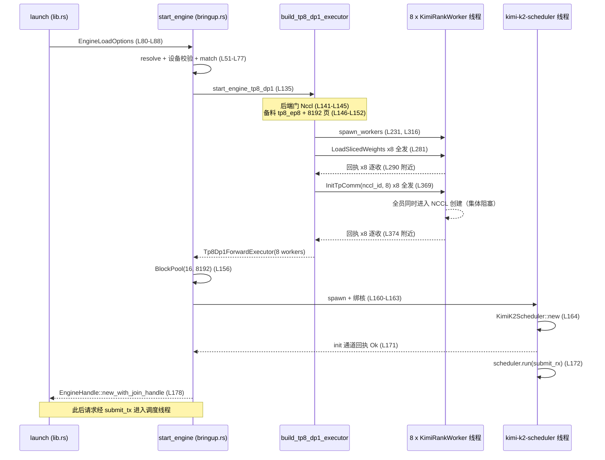
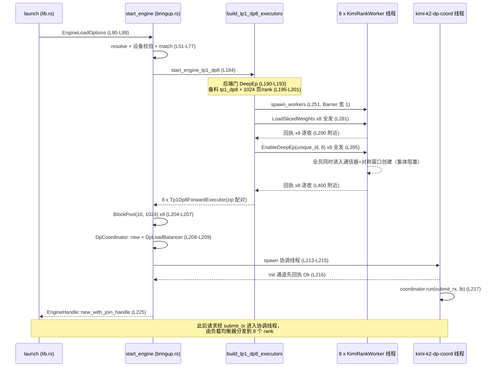

# start_engine：双拓扑启动流程

> **单元 3 · 第 1 讲** ｜ 前置讲义：[u1-l4 构建与运行：feature、CLI 与引擎入口](u1-l4-build-and-run.md)、[u2-l2 rank 切分计划](u2-l2-rank-slicing-plan.md)

## 1. 本讲目标

u1-l4 的终点是「`launch` 组装好 `EngineLoadOptions`，交给 `bringup::start_engine`」。本讲就钻进这个交接点，把启动流程拆到底。学完本讲，你应当能够：

1. **画出两条时序**：独立画出 TP8/DP1 与 TP1/DP8 两条路径从 `start_engine` 到 `EngineHandle::new_with_join_handle` 的函数调用时序，标注每一步经过的函数与通道。
2. **算清一笔显存账**：解释 `KIMI_TP8_KV_POOL_PAGES = 8192` 与 `KIMI_DP_KV_POOL_PAGES_PER_RANK = 1024` 背后的权衡（每 rank 约 9.2×10⁹ B vs 约 1.15×10⁹ B），并能从页大小、层 数、MLA 缓存宽度手算出这两个数。
3. **理解一种并发模式**：「先把命令发给所有 rank，再等待任一响应」——为什么 `init_tp_nccl` / `install_deepep_backends` 的收发顺序一旦颠倒就是死锁。

本讲只读三个主文件：`runner/bringup.rs`（431 行，主战场）、`runner/config.rs`（24 行）、`lib.rs`（90 行），辅以 `worker.rs` 的少量片段。

## 2. 前置知识

### 2.1 TP / DP / EP：同一批 GPU 的三种切法

Kimi-K2 固定使用 8 张 GPU，但「8 张卡怎么分工」有两种答案：

- **TP8/DP1（张量并行 8）**：8 张卡像一台机器的 8 个工人，**合作**算同一个 batch。注意力头按 64/8=8 切到每卡，MoE 的 384 个专家每卡 48 个，每层结果用 NCCL all-reduce 汇合。请求只有一条队列、一个调度器。
- **TP1/DP8（数据并行 8）**：8 张卡各自是完整的推理实例，**分头**服务不同请求；MoE 仍靠专家并行（EP8）+ DeepEP all-to-all 交换 token。请求由一个 DP 协调器按负载分给 rank。
- **EP（专家并行）** 在两种拓扑里都存在（384 专家 / 8 = 每 rank 48 个），区别只是承载 MoE 通信的后端：NCCL（TP8 路径）还是 DeepEP（DP 路径）。

### 2.2 EngineLoadOptions 与 EngineHandle：引擎契约的两端

- `EngineLoadOptions` 是**进**：模型路径之外的启动参数（并行配置、设备表、EP 后端、seed、是否开 CUDA Graph）。
- `EngineHandle` 是**出**：一个可以被服务器握住的句柄，内部持有提交通道的发送端（`submit_tx`）和一个 join 线程句柄。构造点是 `EngineHandle::new_with_join_handle`（两条路径分别在 [src/runner/bringup.rs:L178](https://github.com/openinfer-project/openinfer/blob/09a1a38f8b4938b06ee4e4f63f64fd4feed59434/pegainfer-kimi-k2/src/runner/bringup.rs#L178) 与 [src/runner/bringup.rs:L225](https://github.com/openinfer-project/openinfer/blob/09a1a38f8b4938b06ee4e4f63f64fd4feed59434/pegainfer-kimi-k2/src/runner/bringup.rs#L225)）。

### 2.3 两种通道：tokio mpsc 与 crossbeam bounded

启动代码里出现两种通道，分工固定：

- `mpsc::unbounded_channel::<SubmittedRequest>()`：**提交通道**。前端把请求塞进来，调度线程消费。容量无限，因为提交方不能被引擎背压阻塞。
- `bounded::<Result<()>>(1)`：**一次性握手通道**。启动线程把重活（构造调度器）丢给新线程后，靠它等一个「初始化成功/失败」的回执，容量 1 就够。

### 2.4 Barrier 与「集体操作」

NCCL 通信器和 DeepEP 的对称窗口都是**集体资源**：`Id`（NCCL）或 unique id（DeepEP）由一个进程生成、广播给全部进程，然后**所有进程必须同时进入创建调用**，初始化才能完成——任何一个 rank 晚到，其余 rank 会阻塞在库内部等待。这是理解本讲 4.3 节「先发后收」模式的全部背景。

### 2.5 BlockPool：调度器的逻辑账本

`BlockPool` 来自 `pegainfer-kv-cache`，是**纯逻辑**的页分配账本：它只知道「池里有 N 页、每页 16 个 token、哪些页分给了哪个请求」，不持有任何 GPU 显存。物理显存池在 worker 里按同样的页数单独分配。本讲只需要知道它在启动时被创建；它的 RAII 语义与请求生命周期是 u4-l2 的主题。

## 3. 本讲源码地图

| 文件 | 行数 | 在本讲中的角色 |
|---|---:|---|
| [src/runner/bringup.rs](https://github.com/openinfer-project/openinfer/blob/09a1a38f8b4938b06ee4e4f63f64fd4feed59434/pegainfer-kimi-k2/src/runner/bringup.rs) | 431 | 启动编排器：并行配置分派、两条启动路径、worker 拉起、集体初始化、KV 页池常量 |
| [src/runner/config.rs](https://github.com/openinfer-project/openinfer/blob/09a1a38f8b4938b06ee4e4f63f64fd4feed59434/pegainfer-kimi-k2/src/runner/config.rs) | 24 | `KimiK2RunnerConfig`：启动期一次性组装、之后全程只读的运行时配置包 |
| [src/lib.rs](https://github.com/openinfer-project/openinfer/blob/09a1a38f8b4938b06ee4e4f63f64fd4feed59434/pegainfer-kimi-k2/src/lib.rs) | 90 | crate 入口：`start_engine` 转发与 `launch` 的 `EngineLoadOptions` 组装 |
| [src/runner/worker.rs](https://github.com/openinfer-project/openinfer/blob/09a1a38f8b4938b06ee4e4f63f64fd4feed59434/pegainfer-kimi-k2/src/runner/worker.rs) | 917 | `KimiRankWorker` 线程与命令面（本讲只读 `spawn` 与三个 `*_async` 方法） |
| [src/runner/affinity.rs](https://github.com/openinfer-project/openinfer/blob/09a1a38f8b4938b06ee4e4f63f64fd4feed59434/pegainfer-kimi-k2/src/runner/affinity.rs) | 116 | 线程绑核计划：`for_devices`、`pin_scheduler_thread`、`pin_rank_worker_thread` |
| [src/runner/scheduler.rs](https://github.com/openinfer-project/openinfer/blob/09a1a38f8b4938b06ee4e4f63f64fd4feed59434/pegainfer-kimi-k2/src/runner/scheduler.rs) | — | TP8/DP1 的调度线程：`KimiK2Scheduler::new`（L61）、`run`（L102） |
| [src/runner/scheduler/dp.rs](https://github.com/openinfer-project/openinfer/blob/09a1a38f8b4938b06ee4e4f63f64fd4feed59434/pegainfer-kimi-k2/src/runner/scheduler/dp.rs) | 1459 | TP1/DP8 的协调线程：`DpCoordinator::new`（L175）、`run`（L229） |
| [src/runner/executor.rs](https://github.com/openinfer-project/openinfer/blob/09a1a38f8b4938b06ee4e4f63f64fd4feed59434/pegainfer-kimi-k2/src/runner/executor.rs) | 55 | `ForwardExecutor` trait（L14）：u3-l3 的主角，本讲只看它如何被构造出来 |
| [src/config.rs](https://github.com/openinfer-project/openinfer/blob/09a1a38f8b4938b06ee4e4f63f64fd4feed59434/pegainfer-kimi-k2/src/config.rs) | 358 | 几何常量：61 层（L15）、kv_lora 512（L22）、rope 64（L24）——页预算的数学来源 |

> 永久链接统一指向本仓库当前 HEAD（`09a1a38f`），行号均经 `grep -n` 核实。


## 4. 核心概念与源码讲解

### 4.1 模块一：并行配置解析与设备校验

#### 4.1.1 概念说明

`start_engine` 是 bringup 的唯一入口（[src/runner/bringup.rs:L51](https://github.com/openinfer-project/openinfer/blob/09a1a38f8b4938b06ee4e4f63f64fd4feed59434/pegainfer-kimi-k2/src/runner/bringup.rs#L51)）。在干任何重活之前，它先做三件「门卫」工作：

1. **解析并行配置**。`EngineLoadOptions.parallel_config` 是 `Option<ParallelConfig>`：CLI 路径的 `launch` 一定传 `Some`；直接调库的调用者（测试、内部二进制）可能不传，此时回退到 `ParallelConfig::new(8, 1)`——TP8/DP1。这与 CLI 的默认拓扑（`dp_size` 缺省补 8 → TP1/DP8 + DeepEP）刻意不同，u1-l4 已经讲过这个「策略 owner 在 launch」的设计。
2. **打一行结构化启动日志**（tp/dp/ep/backend/devices 一行全出），这是日后诊断「引擎到底以什么拓扑起来了」的第一入口。
3. **校验设备数**：`device_ordinals.len()` 必须等于 `ep_world()`。两种合法拓扑下 ep_world 都是 8（8×1 与 1×8），所以这条校验对两条路径一视同仁。

门卫放行后才按 **(tp_world, dp_world) 二元组**分派，其它组合一律 `bail!`。

#### 4.1.2 核心流程

```text
launch(model_path, KimiLaunchOptions)            # src/lib.rs L64
  ├─ ensure tp_size > 0 且 dp_size > 0           # 报错文案见 L70
  ├─ parallel = ParallelConfig::new(tp, dp)
  └─ runner::start_engine( &EngineLoadOptions {  # L80-L88
        device_ordinals: 0..ep_world,
        parallel_config: Some(parallel),
        ep_backend, cuda_graph, seed: 42 })

start_engine(model_path, options)                # src/runner/bringup.rs L51
  ├─ resolve_parallel_config(options)            # L81-L85   未传则回退 (8,1)
  ├─ info!("resolving engine startup: …")        # L53-L61   tp/dp/ep/backend/devices
  ├─ ensure!(devices.len() == ep_world)          # L62-L68   门卫：设备数
  └─ match (tp_world, dp_world)                  # L69-L77   分派表
        (8, 1) => start_engine_tp8_dp1(...)      # L71
        (1, 8) => start_engine_tp1_dp8(...)      # L72
        _       => bail!("not yet supported")    # L73-L76   v1 只有两种组合
```

#### 4.1.3 源码精读

**入口转发**。[src/lib.rs:L40-L41](https://github.com/openinfer-project/openinfer/blob/09a1a38f8b4938b06ee4e4f63f64fd4feed59434/pegainfer-kimi-k2/src/lib.rs#L40-L41) 是 feature 门内的 `start_engine`，一行转发给 runner；门外的同名桩（[src/lib.rs:L45](https://github.com/openinfer-project/openinfer/blob/09a1a38f8b4938b06ee4e4f63f64fd4feed59434/pegainfer-kimi-k2/src/lib.rs#L45)）直接报「rebuild with --features kimi-k2」（u1-l4）。`launch` 的收尾把 CLI 值翻译成引擎契约：

```rust
// src/lib.rs L80-L88：launch 的收尾——设备表就是 0..ep_world，seed 固定 42
runner::start_engine(
    model_path,
    &EngineLoadOptions {
        enable_cuda_graph: options.cuda_graph,
        device_ordinals: (0..parallel.ep_world()).collect(),
        parallel_config: Some(parallel),
        ep_backend: options.ep_backend,
        seed: 42,
    },
)
```

[src/lib.rs:L80-L88](https://github.com/openinfer-project/openinfer/blob/09a1a38f8b4938b06ee4e4f63f64fd4feed59434/pegainfer-kimi-k2/src/lib.rs#L80-L88) —— `seed: 42` 只在 DP 路径被继续传递（见 4.2 节 `DpCoordinator::new`）；TP8 路径的采样不走这条 seed（u7-l2 展开）。

**设备数硬校验**：

```rust
// src/runner/bringup.rs L62-L68：拓扑要多少卡，就必须给多少卡
ensure!(
    options.device_ordinals.len() == parallel.ep_world(),
    "Kimi-K2 {:?} requires {} devices, got {:?}",
    parallel,
    parallel.ep_world(),
    options.device_ordinals
);
```

[src/runner/bringup.rs:L62-L68](https://github.com/openinfer-project/openinfer/blob/09a1a38f8b4938b06ee4e4f63f64fd4feed59434/pegainfer-kimi-k2/src/runner/bringup.rs#L62-L68) —— 报错里带完整的 `ParallelConfig`、需要的设备数和实际设备表，一眼能看出「几卡的模型配了几卡的环境」。

**拓扑分派表**：

```rust
// src/runner/bringup.rs L71-L74：v1 只支持两种 (TP, DP) 组合
(8, 1) => start_engine_tp8_dp1(model_path, options, parallel),
(1, 8) => start_engine_tp1_dp8(model_path, options, parallel),
_ => bail!(
    "Kimi-K2 TP{}/DP{} not yet supported (v1: TP8DP1 or TP1DP8)",
```

[src/runner/bringup.rs:L71-L74](https://github.com/openinfer-project/openinfer/blob/09a1a38f8b4938b06ee4e4f63f64fd4feed59434/pegainfer-kimi-k2/src/runner/bringup.rs#L71-L74) —— 分派只看 `(tp_world, dp_world)`，`ep_backend` 的合法性由各分支自己再校验（见 4.2 节）。

**库路径的回退**：

```rust
// src/runner/bringup.rs L81-L85：不传 parallel_config 的库调用者拿到 TP8/DP1
fn resolve_parallel_config(options: &EngineLoadOptions) -> ParallelConfig {
    options
        .parallel_config
        .unwrap_or_else(|| ParallelConfig::new(8, 1))
}
```

[src/runner/bringup.rs:L81-L85](https://github.com/openinfer-project/openinfer/blob/09a1a38f8b4938b06ee4e4f63f64fd4feed59434/pegainfer-kimi-k2/src/runner/bringup.rs#L81-L85)

#### 4.1.4 代码实践：三条报错路径的桌面推演

1. **实践目标**：不动手运行，仅读源码就能预言三种错误输入的报错文案与触发先后。
2. **操作步骤**：对照下表逐条在源码里找到位置（本节链接 + 4.2 节的后端门）。

   | 输入 | 触发位置 | 报错关键词 |
   |---|---|---|
   | `parallel_config = Some(ParallelConfig::new(2, 4))` | [L73-L76](https://github.com/openinfer-project/openinfer/blob/09a1a38f8b4938b06ee4e4f63f64fd4feed59434/pegainfer-kimi-k2/src/runner/bringup.rs#L73-L76) | `not yet supported (v1: TP8DP1 or TP1DP8)` |
   | `(8,1)` + `ep_backend = DeepEp` | [L141-L145](https://github.com/openinfer-project/openinfer/blob/09a1a38f8b4938b06ee4e4f63f64fd4feed59434/pegainfer-kimi-k2/src/runner/bringup.rs#L141-L145) | `has no TP8 path` |
   | `(1,8)` + `ep_backend = Nccl` | [L190-L193](https://github.com/openinfer-project/openinfer/blob/09a1a38f8b4938b06ee4e4f63f64fd4feed59434/pegainfer-kimi-k2/src/runner/bringup.rs#L190-L193) | `requires --ep-backend=deepep` |

3. **需要观察的现象**：三张「门」的相对位置——设备数门在 `match` 之前，所以 `new(2,4)` 且只给 4 张卡时，先撞设备数门而不是拓扑门。
4. **预期结果**：能不看代码复述三句报错；能解释为什么后端门长在各分支内部而不是 `start_engine` 里（答案：`start_engine` 只认拓扑，后端绑定是拓扑的属性，两种拓扑各认一个后端）。
5. 本实践为纯源码阅读，无 GPU 也可完成，不涉及本地运行验证。

#### 4.1.5 小练习与答案

**练习 1**：`ep_world()` 在两种合法拓扑下各是多少？为什么设备数校验可以只用这一个数？

> **答**：都是 8。TP8/DP1 是 8×1，TP1/DP8 是 1×8；Kimi-K2 的专家并行世界恒为 8 卡，设备需求与拓扑无关。

**练习 2**：为什么库路径默认回退 TP8/DP1，而 CLI 默认 TP1/DP8？

> **答**：CLI 的 `launch` 是拓扑策略的 owner（u1-l4），`dp_size` 缺省补 8；库路径不知道调用者意图，选了不需要 DeepEP 环境、单队列的保守组合 TP8/DP1（NCCL 路径）。

**练习 3**：调用者传了 4 个 `device_ordinals` 且 `parallel_config = None`，会看到什么？

> **答**：先回退 `(8,1)`，`ep_world = 8`，随后 [L62-L68](https://github.com/openinfer-project/openinfer/blob/09a1a38f8b4938b06ee4e4f63f64fd4feed59434/pegainfer-kimi-k2/src/runner/bringup.rs#L62-L68) 的 `ensure!` 失败：`requires 8 devices, got [..]`，错误里会列出那 4 个序号。


### 4.2 模块二：两条启动分支

#### 4.2.1 概念说明

两条分支共享同一个七步骨架：**后端门 → 备料 → EOS → 组执行器 → 逻辑账本 → 调度线程 → 握手返回**。差异被压缩在三处（正是本讲要求掌握的三处差异）：

- **TP8/DP1**：一个 `KimiK2Scheduler` 单调度器管一条请求队列；MoE 走 NCCL；一本 `BlockPool` 记全池的账。执行器形态是**一个** `Tp8Dp1ForwardExecutor`，内部持有全部 8 个 worker。
- **TP1/DP8**：一个 `DpCoordinator` 协调线程以 lock-step 驱动 8 个 rank（u4-l3 展开）；MoE 走 DeepEP；**每 rank 一本** `BlockPool`。执行器形态是**八个** `Tp1Dp8ForwardExecutor`，`workers.into_iter().zip(weight_reports)` 一一配对，每个只持一个 worker。

「备料」函数 `build_runner_config` 是两路共用的：它把 u2-l1/u2-l2 的产物（权重清单、rank 切分计划）与设备表、线程绑核计划组装成 `KimiK2RunnerConfig`，从此全程只读。两条路径只给它两个不同参数：并行形状（`tp8_ep8()` vs `tp1_dp8()`）与 KV 页池预算（8192 vs 每 rank 1024，见 4.4 节）。

#### 4.2.2 核心流程

**TP8/DP1 路径时序**（行号均已核实，下同）：

```text
start_engine_tp8_dp1(model_path, options, parallel)    # L135
 ① 后端门：ensure ep_backend == Nccl                   # L141-L145
 ② 备料：build_runner_config(shape=tp8_ep8,            # L146-L152
        kv_pool_pages=KIMI_TP8_KV_POOL_PAGES=8192)     #   L151
     ├─ ensure_text_only_model_index（解析索引）         #   L96
     ├─ with_parallel_shape(tp8_ep8)（重校验整除）        #   L97
     ├─ build_placements(device_ordinals)（rank↔卡）      #   L98
     ├─ KimiRankThreadPlacementPlan::for_devices        #   L99-L101
     ├─ rank_weight_names × 8                           #   L102-L104
     └─ rank_sliced_load_plan × 8                       #   L105-L107
 ③ EOS：eos_token_ids(model_path, KIMI_K2_VOCAB)       # L153
 ④ 组执行器：build_tp8_dp1_executor(&config)            # L228 起
     ├─ spawn_workers                                   #   L231
     │    ├─ KimiRankGpuContext::new(device) × 8       #   L328
     │    ├─ collective_barrier = Barrier::new(tp=8)    #   L330
     │    └─ KimiRankWorker::spawn × 8                  #   L340-L350
     ├─ maybe_load_rank_weights                         #   L233
     │    ├─ ensure_weight_payload_available            #     L278
     │    ├─ load_sliced_weights_async × 8（先全发）      #     L281
     │    └─ recv × 8（后逐收，带 rank 上下文）            #     L290 附近
     └─ init_tp_nccl                                    #   L234
          ├─ nccl Id::new()                             #     L365
          ├─ init_tp_comm_async(id, 8) × 8（先全发）      #     L369
          └─ recv × 8（后逐收）                           #     L374 附近
 ⑤ 逻辑账本：BlockPool::new(KIMI_KV_PAGE_SIZE, 8192)    # L156
 ⑥ 提交通道：mpsc::unbounded_channel<SubmittedRequest>  # L158
 ⑦ init 握手通道：bounded::<Result<()>>(1)               # L159
 ⑧ 调度线程 "kimi-k2-scheduler"                         # L160-L173
     ├─ pin_scheduler_thread（绑核）                      #   L163
     ├─ KimiK2Scheduler::new(executor, eos, pool)       #   L164
     ├─ init_tx.send(Err/Ok)（构造结果回传）               #   L167 / L171
     └─ scheduler.run(submit_rx)                        #   L172
 ⑨ 主线程 init_rx.recv()?? 等回执
 ⑩ EngineHandle::new_with_join_handle(submit_tx,       # L178
        scheduler_handle)
```


**TP1/DP8 路径时序**：

```text
start_engine_tp1_dp8(model_path, options, parallel)    # L184
 ① 后端门：ensure ep_backend == DeepEp                 # L190-L193
 ② 备料：build_runner_config(shape=tp1_dp8,            # L195-L201
        kv_pool_pages=KIMI_DP_KV_POOL_PAGES_PER_RANK=1024)  # L200
 ③ EOS：eos_token_ids(model_path, KIMI_K2_VOCAB)       # L202
 ④ 组执行器：build_tp1_dp8_executors(&config)           # L246 起
     ├─ spawn_workers（Barrier 宽度 = tp_world = 1）      #   L251
     ├─ maybe_load_rank_weights                         #   L253
     └─ install_deepep_backends                         #   L254
          ├─ deepep_unique_id()                         #     L392
          ├─ enable_deepep_async(id, 8) × 8（先全发）     #     L395
          └─ recv × 8（后逐收）                           #     L400 附近
 ⑤ 逻辑账本：BlockPool::new × 8（每 rank 一本）           # L204-L207（L206）
 ⑥ 协调器：DpCoordinator::new(executors, eos, seed, pools)  # L208
 ⑦ 负载均衡器：DpLoadBalancer::new(dp_world)             # L209
 ⑧ 提交通道 mpsc::unbounded_channel                     # L211
    + init 握手通道 bounded::<Result<()>>(1)              # L212
 ⑨ 协调线程 "kimi-k2-dp-coord"                          # L213-L219
     ├─ init_tx.send(Ok(()))（先回执再进循环）             #   L216
     └─ coordinator.run(submit_rx, lb)                  #   L217
 ⑩ 主线程 init_rx.recv()?? 等回执
 ⑪ EngineHandle::new_with_join_handle(submit_tx, coord_handle)  # L225
```

**两条路径的三处关键差异**：

| 维度 | TP8/DP1 | TP1/DP8 |
|---|---|---|
| MoE 后端 | NCCL（[L141-L145](https://github.com/openinfer-project/openinfer/blob/09a1a38f8b4938b06ee4e4f63f64fd4feed59434/pegainfer-kimi-k2/src/runner/bringup.rs#L141-L145) 强制） | DeepEP（[L190-L193](https://github.com/openinfer-project/openinfer/blob/09a1a38f8b4938b06ee4e4f63f64fd4feed59434/pegainfer-kimi-k2/src/runner/bringup.rs#L190-L193) 强制） |
| BlockPool 数量 | 1 本，记 8192 页全池的账（[L156](https://github.com/openinfer-project/openinfer/blob/09a1a38f8b4938b06ee4e4f63f64fd4feed59434/pegainfer-kimi-k2/src/runner/bringup.rs#L156)） | 8 本，每 rank 记自己 1024 页（[L206](https://github.com/openinfer-project/openinfer/blob/09a1a38f8b4938b06ee4e4f63f64fd4feed59434/pegainfer-kimi-k2/src/runner/bringup.rs#L206)） |
| 调度线程 | `"kimi-k2-scheduler"`（[L161](https://github.com/openinfer-project/openinfer/blob/09a1a38f8b4938b06ee4e4f63f64fd4feed59434/pegainfer-kimi-k2/src/runner/bringup.rs#L161)）跑 `KimiK2Scheduler::run`（[L172](https://github.com/openinfer-project/openinfer/blob/09a1a38f8b4938b06ee4e4f63f64fd4feed59434/pegainfer-kimi-k2/src/runner/bringup.rs#L172)） | `"kimi-k2-dp-coord"`（[L214](https://github.com/openinfer-project/openinfer/blob/09a1a38f8b4938b06ee4e4f63f64fd4feed59434/pegainfer-kimi-k2/src/runner/bringup.rs#L214)）跑 `DpCoordinator::run` + `DpLoadBalancer`（[L209](https://github.com/openinfer-project/openinfer/blob/09a1a38f8b4938b06ee4e4f63f64fd4feed59434/pegainfer-kimi-k2/src/runner/bringup.rs#L209)、[L217](https://github.com/openinfer-project/openinfer/blob/09a1a38f8b4938b06ee4e4f63f64fd4feed59434/pegainfer-kimi-k2/src/runner/bringup.rs#L217)） |

其余差异顺带记两笔：

- **执行器形态**：1 个执行器持 8 个 worker（[L231-L234](https://github.com/openinfer-project/openinfer/blob/09a1a38f8b4938b06ee4e4f63f64fd4feed59434/pegainfer-kimi-k2/src/runner/bringup.rs#L231-L234)）vs 8 个执行器各持 1 个 worker（[L251-L254](https://github.com/openinfer-project/openinfer/blob/09a1a38f8b4938b06ee4e4f63f64fd4feed59434/pegainfer-kimi-k2/src/runner/bringup.rs#L251-L254)）。
- **init 握手时机与 seed 去向**：TP8 在新线程里构造调度器、成败经 init 通道回传（[L164](https://github.com/openinfer-project/openinfer/blob/09a1a38f8b4938b06ee4e4f63f64fd4feed59434/pegainfer-kimi-k2/src/runner/bringup.rs#L164)、[L171](https://github.com/openinfer-project/openinfer/blob/09a1a38f8b4938b06ee4e4f63f64fd4feed59434/pegainfer-kimi-k2/src/runner/bringup.rs#L171)）；DP 协调器在主线程构造完，新线程先回执再进循环（[L216](https://github.com/openinfer-project/openinfer/blob/09a1a38f8b4938b06ee4e4f63f64fd4feed59434/pegainfer-kimi-k2/src/runner/bringup.rs#L216)）。只有 DP 路径把 `options.seed` 交给协调器（[L208](https://github.com/openinfer-project/openinfer/blob/09a1a38f8b4938b06ee4e4f63f64fd4feed59434/pegainfer-kimi-k2/src/runner/bringup.rs#L208)），供每步每 rank 派发采样种子（u4-l3、u7-l2 展开）。

#### 4.2.3 源码精读

**TP8/DP1 的前半**（后端门 + 备料 + 页池参数）：

```rust
// src/runner/bringup.rs L141-L145：TP8/DP1 的后端门
ensure!(
    options.ep_backend == EpBackend::Nccl,
    "Kimi-K2 TP8/DP1 routes MoE through the NCCL backend; --ep-backend={:?} has no TP8 path",
    options.ep_backend
);
```

```rust
// src/runner/bringup.rs L146-L152：备料调用——拓扑形状与页池预算是仅有的两个差异参数
let config = build_runner_config(
    model_path,
    options,
    parallel,
    KimiK2ParallelShape::tp8_ep8(),
    KIMI_TP8_KV_POOL_PAGES,
)?;
```

[src/runner/bringup.rs:L146-L152](https://github.com/openinfer-project/openinfer/blob/09a1a38f8b4938b06ee4e4f63f64fd4feed59434/pegainfer-kimi-k2/src/runner/bringup.rs#L146-L152) —— 对比 DP 侧的同名调用（[L195-L201](https://github.com/openinfer-project/openinfer/blob/09a1a38f8b4938b06ee4e4f63f64fd4feed59434/pegainfer-kimi-k2/src/runner/bringup.rs#L195-L201)），只有最后两个实参换成 `KimiK2ParallelShape::tp1_dp8()` 与 `KIMI_DP_KV_POOL_PAGES_PER_RANK`（[L200](https://github.com/openinfer-project/openinfer/blob/09a1a38f8b4938b06ee4e4f63f64fd4feed59434/pegainfer-kimi-k2/src/runner/bringup.rs#L200)）。

**备料的内部**（两路共用，消费 u2 的全部产物）：

```rust
// src/runner/bringup.rs L96-L107：清单 → 切片计划 → 放置 → 绑核，五件事备齐
let mut weight_manifest = ensure_text_only_model_index(model_path)?;
weight_manifest = weight_manifest.with_parallel_shape(shape)?;
let placements = build_placements(&options.device_ordinals)?;
let thread_placement = crate::runner::affinity::KimiRankThreadPlacementPlan::for_devices(
    &options.device_ordinals,
)?;
let rank_weight_names = (0..placements.len())
    .map(|rank| weight_manifest.rank_weight_names(rank))
    .collect::<Result<Vec<_>>>()?;
let rank_sliced_load_plans = (0..placements.len())
    .map(|rank| weight_manifest.rank_sliced_load_plan(rank))
    .collect::<Result<Vec<_>>>()?;
```

[src/runner/bringup.rs:L96-L107](https://github.com/openinfer-project/openinfer/blob/09a1a38f8b4938b06ee4e4f63f64fd4feed59434/pegainfer-kimi-k2/src/runner/bringup.rs#L96-L107) —— `with_parallel_shape` 会在新拓扑下重跑整除校验（u2-l1 的 `validate`）；`rank_weight_names` / `rank_sliced_load_plan` 正是 u2-l2 讲的 rank 切分产物。组装结果 `KimiK2RunnerConfig` 定义在 [src/runner/config.rs:L11-L23](https://github.com/openinfer-project/openinfer/blob/09a1a38f8b4938b06ee4e4f63f64fd4feed59434/pegainfer-kimi-k2/src/runner/config.rs#L11-L23)，其 `kv_pool_pages` 字段的文档注释明确写着：物理 MLA 池与调度器的逻辑 `BlockPool` 都由它定尺寸，「记账与显存缓冲永远不会对不上」。

**TP8/DP1 的后半**（通道 + 调度线程 + 句柄）：

```rust
// src/runner/bringup.rs L158-L159：两条通道——提交无限量，握手一次性
let (submit_tx, submit_rx) = mpsc::unbounded_channel::<SubmittedRequest>();
let (init_tx, init_rx) = bounded::<Result<()>>(1);
```

```rust
// src/runner/bringup.rs L160-L173：调度线程；构造失败也必须经 init 通道传回，
// 否则主线程会把一个注定失败的引擎当成启动成功
let scheduler_handle = thread::Builder::new()
    .name("kimi-k2-scheduler".into())
    .spawn(move || {
        pin_scheduler_thread(&config.thread_placement);
        let mut scheduler = match KimiK2Scheduler::new(executor, stop_token_ids, pool) {
            Ok(scheduler) => scheduler,
            Err(err) => {
                let _ = init_tx.send(Err(err));
                return;
            }
        };
        let _ = init_tx.send(Ok(()));
        scheduler.run(submit_rx);
    })
```

[src/runner/bringup.rs:L160-L173](https://github.com/openinfer-project/openinfer/blob/09a1a38f8b4938b06ee4e4f63f64fd4feed59434/pegainfer-kimi-k2/src/runner/bringup.rs#L160-L173) —— 主线程随后 `init_rx.recv()??`，成功才在 [L178](https://github.com/openinfer-project/openinfer/blob/09a1a38f8b4938b06ee4e4f63f64fd4feed59434/pegainfer-kimi-k2/src/runner/bringup.rs#L178) 构造 `EngineHandle`。`KimiK2Scheduler::new` 内部会用 padding 页预热 bs64 的 decode arena（u4-l1 展开），所以「构造」本身有失败可能。

**TP1/DP8 的对应段**：

```rust
// src/runner/bringup.rs L208-L217：协调器 + 负载均衡器 + 协调线程
let coordinator = DpCoordinator::new(executors, stop_token_ids, options.seed, pools);
let lb = DpLoadBalancer::new(dp_world);
let (submit_tx, submit_rx) = mpsc::unbounded_channel::<SubmittedRequest>();
let (init_tx, init_rx) = bounded::<Result<()>>(1);
let coord_handle = thread::Builder::new()
    .name("kimi-k2-dp-coord".into())
    .spawn(move || {
        let _ = init_tx.send(Ok(()));
        coordinator.run(submit_rx, lb);
```

[src/runner/bringup.rs:L208-L217](https://github.com/openinfer-project/openinfer/blob/09a1a38f8b4938b06ee4e4f63f64fd4feed59434/pegainfer-kimi-k2/src/runner/bringup.rs#L208-L217) —— 注意顺序差：DP 侧的重活（构造 `DpCoordinator`）都在主线程做完，新线程第一件事就是 `send(Ok(()))`；8 本 `BlockPool` 在 [L204-L207](https://github.com/openinfer-project/openinfer/blob/09a1a38f8b4938b06ee4e4f63f64fd4feed59434/pegainfer-kimi-k2/src/runner/bringup.rs#L204-L207) 按 `(0..dp_world)` 逐本创建后整个交给协调器。最终句柄在 [L225](https://github.com/openinfer-project/openinfer/blob/09a1a38f8b4938b06ee4e4f63f64fd4feed59434/pegainfer-kimi-k2/src/runner/bringup.rs#L225)。

**执行器的组装对比**（三步流水，只有第三步不同）：

```rust
// src/runner/bringup.rs L231-L234：TP8——拉起 → 装载 → 组 NCCL 网
let workers = spawn_workers(config)?;
let weight_reports =
    maybe_load_rank_weights(&config.model_path, &config.rank_sliced_load_plans, &workers)?;
init_tp_nccl(&workers)?;
```

```rust
// src/runner/bringup.rs L251-L254：DP——拉起 → 装载 → 装 DeepEP 后端
let workers = spawn_workers(config)?;
let weight_reports =
    maybe_load_rank_weights(&config.model_path, &config.rank_sliced_load_plans, &workers)?;
install_deepep_backends(&workers)?;
```

[src/runner/bringup.rs:L231-L234](https://github.com/openinfer-project/openinfer/blob/09a1a38f8b4938b06ee4e4f63f64fd4feed59434/pegainfer-kimi-k2/src/runner/bringup.rs#L231-L234) 与 [src/runner/bringup.rs:L251-L254](https://github.com/openinfer-project/openinfer/blob/09a1a38f8b4938b06ee4e4f63f64fd4feed59434/pegainfer-kimi-k2/src/runner/bringup.rs#L251-L254) —— TP8 随后把**整个** `workers` 向量塞进唯一的 `Tp8Dp1ForwardExecutor`；DP 侧则 `zip` 成 8 个 `Tp1Dp8ForwardExecutor`，每个执行器独占一个 worker（`ForwardExecutor` trait 见 [src/runner/executor.rs:L14](https://github.com/openinfer-project/openinfer/blob/09a1a38f8b4938b06ee4e4f63f64fd4feed59434/pegainfer-kimi-k2/src/runner/executor.rs#L14)，u3-l3 精读）。

#### 4.2.4 代码实践：日志顺序拼图

1. **实践目标**：不看运行日志，仅凭源码排出两条路径的启动日志顺序，为综合实践的时序图做铺垫。
2. **操作步骤**：下面 9 条 `info!` 文案打乱了顺序，请分别按 TP8/DP1 与 TP1/DP8 两条路径排出先后，并用 `grep -n "文案片段" src/runner/bringup.rs` 在源码中定位每条：

   ```text
   A "resolving engine startup: …"
   B "starting TP8/DP1 engine"
   C "starting TP1/DP8 engine"
   D "start build runner config"
   E "start spawn rank workers: ranks=8"
   F "start load rank weights: ranks=8"
   G "start TP NCCL init: ranks=8"
   H "stop tokens: [..]"
   I "TP1 DP8 coordinated engine started"
   ```

3. **需要观察的现象**：`resolving` 一定第一条（分派之前）；`stop tokens` 出现在备料之后、组执行器之前；NCCL / DeepEP 的初始化日志在权重加载之后。
4. **预期结果**：TP8/DP1 为 A→B→D→H→E→F→G（再接 "build TP8/DP1 executor cost" 收尾）；TP1/DP8 为 A→C→D→H→E→F→（"start install DeepEP EP backend"）→I。若在 8 卡机器上实际启动，日志应与此一致（待本地验证）。
5. 排序部分无 GPU 即可完成；真机日志核对需 8 GPU 与 Kimi-K2 权重，属可选验证。

#### 4.2.5 小练习与答案

**练习 1**：为什么 TP8 路径只有一本 `BlockPool`，DP 有 8 本？

> **答**：`BlockPool` 是调度器的逻辑账本。TP8 单调度器统一记账全池；DP 每个 rank 独立调度自己的请求与槽位，各持一本账，彼此不感知对方的页分配。

**练习 2**：init 握手通道在两条路径里的语义差别是什么？

> **答**：TP8：线程内做重活（构造 `KimiK2Scheduler`），成败经通道回传，主线程等到回执才交付 `EngineHandle`；DP：协调器已在主线程构造完，新线程先 `send(Ok(()))` 再进 `run`——通道只承担「线程已启动」的回执。

**练习 3**：如果把 `DpCoordinator::new` 的 `pools` 换成 8 个 rank 共享同一本 `BlockPool`，会发生什么？

> **答**：8 个 rank 的调度状态会互相踩页分配（同一逻辑页号被不同请求同时持有、RAII 归还互相干扰）。每个 DP rank 必须有独立账本，这正是 [L204-L207](https://github.com/openinfer-project/openinfer/blob/09a1a38f8b4938b06ee4e4f63f64fd4feed59434/pegainfer-kimi-k2/src/runner/bringup.rs#L204-L207) 逐本创建的原因（`RequestKv` 的 RAII 语义见 u4-l2）。


### 4.3 模块三：worker 拉起与集体初始化

#### 4.3.1 概念说明

**KimiRankWorker = 每个 rank 一个 OS 线程的把手**。`spawn` 完成后，主线程（bringup 所在线程）不再直接碰 GPU——所有 GPU 工作都变成「命令」：每条命令经一条 unbounded 的 crossbeam 通道发给 rank 线程，并自带一个 `bounded(1)` 的响应通道。所以 `*_async` 方法的语义是「发命令、拿回 `Receiver`、立即返回」，真正的执行发生在 rank 线程里（线程模型全貌是 u3-l2 的主题）。

启动期用到三条命令，性质不同：

- `LoadSlicedWeights`：**单 rank 各自干**——各读各的 shard 切片，互不依赖（u2-l4 的加载链路）。先全发是为了 8 个线程**并行** mmap + H2D，把总时间压到最慢一个 rank。
- `InitTpComm`：**集体**——8 个 rank 必须同时进入 NCCL 通信器创建，晚到的让早到的阻塞在库内部。
- `EnableDeepEp`：**集体**——NCCL 通信器 + DeepEP 对称窗口创建，同样要全员到齐。

对集体命令，bringup 有一条铁律，源码注释写得非常直白（[src/runner/bringup.rs:L385-L388](https://github.com/openinfer-project/openinfer/blob/09a1a38f8b4938b06ee4e4f63f64fd4feed59434/pegainfer-kimi-k2/src/runner/bringup.rs#L385-L388)）：

> Collective DeepEP bootstrap: rank 0's unique id fans out to every rank worker, which all enter the NCCL communicator + symmetric-window create together. **Send to all ranks before waiting on any response** — each worker blocks inside the collective until the last rank joins.

此外 spawn_workers 还建了一把 `Barrier`，宽度是 `tp_world`（[L330](https://github.com/openinfer-project/openinfer/blob/09a1a38f8b4938b06ee4e4f63f64fd4feed59434/pegainfer-kimi-k2/src/runner/bringup.rs#L330)）：TP8 下宽 8，供 worker 之间运行期锁步；TP1/DP8 下宽 1（每个 rank 自成一个 TP 组），跨 rank 的步进交给 DeepEP 的 dispatch/combine。

#### 4.3.2 核心流程

**spawn_workers 五步**：

```text
① 校验三份 per-rank 名单长度一致（placements / names / sliced plans）   # L320-L325
② 每个 placement 建一个 KimiRankGpuContext::new(device_ordinal)          # L326-L331
   ——每 rank 独立的 CUDA 上下文，绑定到该卡
③ 一把宽度 tp_world 的 Barrier（Arc 共享给全部 worker）                   # L330
④ 逐 rank KimiRankWorker::spawn（九参）：
   ├─ 校验 names / plans / thread 三者的 rank 一致                        # worker.rs L275 起
   ├─ 建 unbounded 命令通道 + bounded(1) startup 通道
   ├─ 起线程 "kimi-k2-rank-{rank}" → 绑核 → 绑 CUDA 上下文
   └─ 等待 startup 回执后把 worker 把手交回主线程
⑤ debug_assert_eq!(worker.placement(), placement)                        # L351
```

**集体命令的收发模式**（先全发、后逐收）：

```text
# 反面教材（会死锁）：
r0 = w0.init_tp_comm_async(id, 8)   # rank0 线程进入 NCCL 创建，阻塞等其余 7 个
r0.recv()                           # ← 主线程卡死：另外 7 个的命令还没发出去

# 实际代码（bringup.rs L369 发全部 → L372-L376 逐个收）：
receivers = workers.map(|w| w.init_tp_comm_async(id, 8))   # ① 八条命令全部出膛
for r in receivers { r.recv()? }                            # ② 再逐个收回执
```

权重加载（[L281](https://github.com/openinfer-project/openinfer/blob/09a1a38f8b4938b06ee4e4f63f64fd4feed59434/pegainfer-kimi-k2/src/runner/bringup.rs#L281) 先全发、随后逐收）形式上同构，但目的不同：它不是集体，先全发换的是**并行加载**。加载前还有一道 fail-fast 保险：`ensure_weight_payload_available` 先把全部 rank 计划要打开的 shard 文件名去重、逐一检查存在性（[L411-L431](https://github.com/openinfer-project/openinfer/blob/09a1a38f8b4938b06ee4e4f63f64fd4feed59434/pegainfer-kimi-k2/src/runner/bringup.rs#L411-L431)）——缺文件时立刻报 `found X/Y planned shards`，而不是让 8 个线程各加载一半才失败。

#### 4.3.3 源码精读

**spawn_workers 的核心两步**：

```rust
// src/runner/bringup.rs L328-L330（节选）：每卡一个 CUDA 上下文 + 一把 TP 宽度的 Barrier
        .map(|placement| KimiRankGpuContext::new(placement.device_ordinal))
        .collect::<Result<Vec<_>>>()?;
    let collective_barrier = Arc::new(Barrier::new(config.parallel.tp_world()));
```

```rust
// src/runner/bringup.rs L340-L350（节选）：九个参数——worker 的全部身家
        let worker = KimiRankWorker::spawn(
            placement,
            weight_names,
            sliced_load_plan,
            thread_placement,
            config.local_dims,
            ctx,
            Arc::clone(&collective_barrier),
            config.enable_cuda_graph,
            config.kv_pool_pages,
        )?;
```

[src/runner/bringup.rs:L340-L350](https://github.com/openinfer-project/openinfer/blob/09a1a38f8b4938b06ee4e4f63f64fd4feed59434/pegainfer-kimi-k2/src/runner/bringup.rs#L340-L350) —— `kv_pool_pages` 从这里一路传进 worker，物理 KV 池按它分配（见 4.4 节）；`enable_cuda_graph` 决定 decode 是否走图捕获（u7-l1）。

**worker 侧的 spawn 签名与命令语义**（[src/runner/worker.rs:L264](https://github.com/openinfer-project/openinfer/blob/09a1a38f8b4938b06ee4e4f63f64fd4feed59434/pegainfer-kimi-k2/src/runner/worker.rs#L264) 起）：

```rust
// src/runner/worker.rs L264-L273：spawn 的九个参数
pub(super) fn spawn(
    placement: KimiK2RankPlacement,
    weight_names: KimiRankWeightNames,
    sliced_load_plan: KimiRankSlicedLoadPlan,
    thread_placement: KimiRankThreadPlacement,
    local_dims: crate::config::KimiLocalDims,
    ctx: KimiRankGpuContext,
    collective_barrier: Arc<Barrier>,
    enable_cuda_graph: bool,
    kv_pool_pages: usize,
) -> Result<Self> {
```

`KimiK2RankPlacement` 只有 `rank` 与 `device_ordinal` 两个字段（[src/runner/worker.rs:L158](https://github.com/openinfer-project/openinfer/blob/09a1a38f8b4938b06ee4e4f63f64fd4feed59434/pegainfer-kimi-k2/src/runner/worker.rs#L158)），由 `build_placements`（[src/runner/worker.rs:L835](https://github.com/openinfer-project/openinfer/blob/09a1a38f8b4938b06ee4e4f63f64fd4feed59434/pegainfer-kimi-k2/src/runner/worker.rs#L835)）按 `device_ordinals` 的枚举顺序生成，`new` 内部 `ensure!(rank < 8)`。

**`*_async` 的样子**（所有命令方法同一模式）：

```rust
// src/runner/worker.rs L332-L344：发命令、拿回执通道，立即返回
pub(super) fn load_sliced_weights_async(
    &self,
    model_path: &Path,
) -> Result<Receiver<Result<KimiRankWeightLoadReport>>> {
    let (resp_tx, resp_rx) = bounded(1);
    self.tx
        .send(KimiRankCommand::LoadSlicedWeights {
            model_path: model_path.to_path_buf(),
            resp: resp_tx,
        })
        .map_err(|_| anyhow::anyhow!("Kimi-K2 rank worker channel closed"))?;
    Ok(resp_rx)
}
```

[src/runner/worker.rs:L332-L344](https://github.com/openinfer-project/openinfer/blob/09a1a38f8b4938b06ee4e4f63f64fd4feed59434/pegainfer-kimi-k2/src/runner/worker.rs#L332-L344) —— `init_tp_comm_async`（[L346](https://github.com/openinfer-project/openinfer/blob/09a1a38f8b4938b06ee4e4f63f64fd4feed59434/pegainfer-kimi-k2/src/runner/worker.rs#L346)）与 `enable_deepep_async`（[L435](https://github.com/openinfer-project/openinfer/blob/09a1a38f8b4938b06ee4e4f63f64fd4feed59434/pegainfer-kimi-k2/src/runner/worker.rs#L435)）完全同构，只是命令枚举与负载不同。

**init_tp_nccl：先全发后逐收的样板**：

```rust
// src/runner/bringup.rs L362-L374：生成广播 id → 八条命令全部出膛 → 逐个收回执
fn init_tp_nccl(workers: &[KimiRankWorker]) -> Result<()> {
    let started = Instant::now();
    info!("start TP NCCL init: ranks={}", workers.len());
    let nccl_id = cudarc::nccl::safe::Id::new()
        .map_err(|err| anyhow::anyhow!("Kimi TP NCCL unique id creation failed: {err:?}"))?;
    let comm_receivers = workers
        .iter()
        .map(|worker| worker.init_tp_comm_async(nccl_id, workers.len()))
        .collect::<Result<Vec<_>>>()?;
    for (rank, receiver) in comm_receivers.into_iter().enumerate() {
        receiver
            .recv()
            .map_err(|_| anyhow::anyhow!("Kimi rank {rank} dropped TP comm init response"))?
```

[src/runner/bringup.rs:L362-L374](https://github.com/openinfer-project/openinfer/blob/09a1a38f8b4938b06ee4e4f63f64fd4feed59434/pegainfer-kimi-k2/src/runner/bringup.rs#L362-L374) —— 注意两个 `.map` 的角色：第一个把命令发给 worker（[L369](https://github.com/openinfer-project/openinfer/blob/09a1a38f8b4938b06ee4e4f63f64fd4feed59434/pegainfer-kimi-k2/src/runner/bringup.rs#L369)），第二个把「通道断开」翻译成带 rank 编号的报错（[L374](https://github.com/openinfer-project/openinfer/blob/09a1a38f8b4938b06ee4e4f63f64fd4feed59434/pegainfer-kimi-k2/src/runner/bringup.rs#L374)）——worker 线程若在回执前崩溃，你看到的不是静默挂起，而是「rank N dropped TP comm init response」。

**install_deepep_backends：同一个模式换后端**（[L385-L400](https://github.com/openinfer-project/openinfer/blob/09a1a38f8b4938b06ee4e4f63f64fd4feed59434/pegainfer-kimi-k2/src/runner/bringup.rs#L385-L400)）：unique id 来自 `pegainfer_kernels::ops::deepep_unique_id()`（[L392](https://github.com/openinfer-project/openinfer/blob/09a1a38f8b4938b06ee4e4f63f64fd4feed59434/pegainfer-kimi-k2/src/runner/bringup.rs#L392)），命令 `enable_deepep_async(unique_id, 8)` 八连发（[L395](https://github.com/openinfer-project/openinfer/blob/09a1a38f8b4938b06ee4e4f63f64fd4feed59434/pegainfer-kimi-k2/src/runner/bringup.rs#L395)），随后逐个 `recv` 并把失败包装成「rank N DeepEP enable」（[L400](https://github.com/openinfer-project/openinfer/blob/09a1a38f8b4938b06ee4e4f63f64fd4feed59434/pegainfer-kimi-k2/src/runner/bringup.rs#L400)）。

#### 4.3.4 代码实践：worker 命令面盘点

1. **实践目标**：列出 `KimiRankWorker` 暴露的全部命令方法，并逐条判定「单 rank 操作」还是「集体操作」，理解 bringup 为什么只对其中两条使用「先全发后逐收」的集体纪律。
2. **操作步骤**：在 crate 根目录运行 `grep -n "fn .*_async" src/runner/worker.rs`，应得到六个方法（[L332](https://github.com/openinfer-project/openinfer/blob/09a1a38f8b4938b06ee4e4f63f64fd4feed59434/pegainfer-kimi-k2/src/runner/worker.rs#L332)、[L346](https://github.com/openinfer-project/openinfer/blob/09a1a38f8b4938b06ee4e4f63f64fd4feed59434/pegainfer-kimi-k2/src/runner/worker.rs#L346)、[L362](https://github.com/openinfer-project/openinfer/blob/09a1a38f8b4938b06ee4e4f63f64fd4feed59434/pegainfer-kimi-k2/src/runner/worker.rs#L362)、[L377](https://github.com/openinfer-project/openinfer/blob/09a1a38f8b4938b06ee4e4f63f64fd4feed59434/pegainfer-kimi-k2/src/runner/worker.rs#L377)、[L406](https://github.com/openinfer-project/openinfer/blob/09a1a38f8b4938b06ee4e4f63f64fd4feed59434/pegainfer-kimi-k2/src/runner/worker.rs#L406)、[L435](https://github.com/openinfer-project/openinfer/blob/09a1a38f8b4938b06ee4e4f63f64fd4feed59434/pegainfer-kimi-k2/src/runner/worker.rs#L435)），然后填写下表：

   | 方法（行号） | 命令 | 单 rank / 集体 | 判定依据 |
   |---|---|---|---|
   | `load_sliced_weights_async`（L332） | `LoadSlicedWeights` | 单 rank（并行） | 各 rank 读各的 shard，互不等待 |
   | `init_tp_comm_async`（L346） | `InitTpComm` | **集体** | NCCL 通信器创建需全员同时进入 |
   | `ensure_decode_arena_async`（L362） | `EnsureDecodeArena` | 单 rank | arena 预热是本卡缓冲区操作 |
   | `forward_prompt_next_token_async`（L377） | `ForwardPrompt…` | 单 rank 命令，但 TP8 下 8 条必须同发 | 步进锁步由 executor 保证（u3-l3） |
   | `forward_decode_batch_next_tokens_async`（L406） | `ForwardDecodeBatch…` | 同上 | 同上 |
   | `enable_deepep_async`（L435） | `EnableDeepEp` | **集体** | DeepEP 对称窗口创建需全员到齐 |

3. **需要观察的现象**：启动期三条命令中恰有两条是集体（`InitTpComm`、`EnableDeepEp`），与 bringup 中「先全发后逐收」的两段代码一一对应；运行期的 forward 命令在 TP8 执行器里同样遵循「全部发出再统一收」的模式。
4. **预期结果**：能对任意一条新命令凭其实现（是否调用会阻塞等待同伴的库函数）判断它的集体性，而不是靠背表。
5. 本实践无 GPU 即可完成（纯读代码 + grep）。

#### 4.3.5 小练习与答案

**练习 1**：`collective_barrier` 的宽度为什么取 `tp_world` 而不是固定 8？

> **答**：TP8/DP1 时一个 TP 组就是全部 8 个 rank，宽 8 的 Barrier 让 worker 互相锁步；TP1/DP8 时每个 rank 自成一个 TP 组，宽 1 等价于不等待，跨 rank 的步进由 DeepEP 的 dispatch/combine 集合通信承担（[L330](https://github.com/openinfer-project/openinfer/blob/09a1a38f8b4938b06ee4e4f63f64fd4feed59434/pegainfer-kimi-k2/src/runner/bringup.rs#L330)）。

**练习 2**：把 `maybe_load_rank_weights` 改成逐 rank「发一条、收一条」会死锁吗？代价是什么？

> **答**：不会死锁——权重加载不是集体操作，单 rank 可以独立完成；代价是失去并行，8 个 rank 的 mmap + H2D 串行执行，启动时间大约变成 8 倍的单 rank IO 时间。这就是它虽非集体、也采用「先全发」的原因（[L281](https://github.com/openinfer-project/openinfer/blob/09a1a38f8b4938b06ee4e4f63f64fd4feed59434/pegainfer-kimi-k2/src/runner/bringup.rs#L281)）。

**练习 3**：看到报错 `Kimi rank 3 dropped weight load response`，最可能发生了什么？

> **答**：rank 3 的 worker 线程在送出回执之前就退出（通常是线程内 panic 导致命令通道关闭），`recv()` 返回 `Err`，被 [L290](https://github.com/openinfer-project/openinfer/blob/09a1a38f8b4938b06ee4e4f63f64fd4feed59434/pegainfer-kimi-k2/src/runner/bringup.rs#L290) 附近的 `map_err` 翻译成带 rank 编号的报错——报错永远携带 rank 上下文，方便定位是哪张卡/哪份 shard 出的问题。


### 4.4 模块四：KV 页池预算

#### 4.4.1 概念说明

两个常量与它们的注释是本模块的全部剧本（[src/runner/bringup.rs:L42-L49](https://github.com/openinfer-project/openinfer/blob/09a1a38f8b4938b06ee4e4f63f64fd4feed59434/pegainfer-kimi-k2/src/runner/bringup.rs#L42-L49)）：

```rust
// src/runner/bringup.rs L42-L49（源码注释原文）
/// TP8 replicates the KV pool on every rank: 8192 pages × 16 tokens ×
/// (576 ckv + 64 kpe) bf16 ≈ 9.2 GiB per rank — the same footprint as the
/// old static bs64 arena, now shared across requests instead of sliced
/// into fixed 2048-token slots.
const KIMI_TP8_KV_POOL_PAGES: usize = 8192;
/// DP shards requests across ranks, so each rank only backs its own slots:
/// 1024 pages ≈ 1.15 GiB per rank (the old per-rank arena footprint).
const KIMI_DP_KV_POOL_PAGES_PER_RANK: usize = 1024;
```

为什么**TP8 必须复制**：MLA 把每个 token 的 K/V 压缩成一份**跨全部头共享**的 latent（`kv_lora 512` + `rope 64` = 576 个 bf16 元素）。TP 切的是头（64/8 = 每 rank 8 个头），**不是 token**：任何 rank 的任何头做注意力都要读全部 token 的同一份 latent，所以每个 rank 必须持有全部请求的全部 KV——只能复制。

为什么 **DP 只要 1/8**：DP 分的是**请求**。每个 rank 只服务自己的请求与槽位，只需要自己那份页（1024 页），不需要别人的 KV。

注释还交代了历史：这个页池与「老的静态 bs64 竞技场」同样大，但从「切成固定 2048-token 槽位」的静态分配，进化为跨请求共享的分页分配——同样的显存，利用率完全不同。

#### 4.4.2 核心流程（显存数学）

页大小 16 个 token（[src/runner/worker.rs:L97](https://github.com/openinfer-project/openinfer/blob/09a1a38f8b4938b06ee4e4f63f64fd4feed59434/pegainfer-kimi-k2/src/runner/worker.rs#L97)）。每 token 每层的 MLA 缓存宽度是 512 + 64 = 576 个 bf16 元素（[src/config.rs:L22](https://github.com/openinfer-project/openinfer/blob/09a1a38f8b4938b06ee4e4f63f64fd4feed59434/pegainfer-kimi-k2/src/config.rs#L22)、[src/config.rs:L24](https://github.com/openinfer-project/openinfer/blob/09a1a38f8b4938b06ee4e4f63f64fd4feed59434/pegainfer-kimi-k2/src/config.rs#L24)），每元素 2 字节，共 61 层（[src/config.rs:L15](https://github.com/openinfer-project/openinfer/blob/09a1a38f8b4938b06ee4e4f63f64fd4feed59434/pegainfer-kimi-k2/src/config.rs#L15)）：

\[ \text{每页字节} = 16 \times 576 \times 2 \times 61 = 1{,}124{,}352 \text{ B} \approx 1.07 \text{ MiB} \]

TP8 每 rank 复制一份全池：

\[ 8192 \times 1{,}124{,}352 = 9{,}210{,}691{,}584 \text{ B} \approx 9.21 \times 10^{9} \text{ B} \]

DP 每 rank 只要一小份：

\[ 1024 \times 1{,}124{,}352 = 1{,}151{,}336{,}448 \text{ B} \approx 1.15 \times 10^{9} \text{ B} \]

与注释对账：注释写「≈9.2 GiB」「≈1.15 GiB」——按**十进制 GB（10⁹ B）**理解即与复算吻合（若严格按 GiB = 2³⁰ B 换算则是 8.58 GiB 与 1.07 GiB）；注释括号里的「(576 ckv + 64 kpe)」也需读作「ckv 与 kpe 合计 576」才能复现 9.2 这个数。口径以注释结论为准，推导如上。

**全局账本对比**：

| 维度 | TP8/DP1 | TP1/DP8 |
|---|---|---|
| 每 rank 页数 | 8192 | 1024 |
| 每 rank KV 显存 | ≈9.21×10⁹ B | ≈1.15×10⁹ B |
| 全局 KV 显存 | ≈73.7×10⁹ B（8 份副本） | ≈9.21×10⁹ B（无副本） |
| 每 rank 可缓存 token | 8192×16 = 131,072 | 1024×16 = 16,384 |
| 全局可缓存 token | 131,072（**同一批**请求） | 131,072（**8 份不相交**请求分摊） |

关键洞察：两种拓扑的全局 token 容量数字相同（都是 8192 页 × 16），但语义完全不同——TP8 是「同一批 token 存了 8 份」（每个 rank 都要参与每个 token 的计算），DP 是「8 份互不相交的请求各存 1 份」。TP8 用 8 倍全局 KV 显存换单请求的跨卡并行；DP 省下的 ≈62×10⁹ B 显存留给更大的 batch、更长的上下文或更多余量。

#### 4.4.3 源码精读

**预算的单一事实来源**。`kv_pool_pages` 是 `KimiK2RunnerConfig` 的一个字段，它的文档注释就是设计合同（[src/runner/config.rs:L11-L23](https://github.com/openinfer-project/openinfer/blob/09a1a38f8b4938b06ee4e4f63f64fd4feed59434/pegainfer-kimi-k2/src/runner/config.rs#L11-L23)）：物理 MLA 池与调度器的逻辑 `BlockPool` **都由它定尺寸**，所以「块记账与 GPU 缓冲永远不会对不上」。它的三个消费点：

- bringup 建**逻辑账本**：TP8 一本 8192 页（[L151](https://github.com/openinfer-project/openinfer/blob/09a1a38f8b4938b06ee4e4f63f64fd4feed59434/pegainfer-kimi-k2/src/runner/bringup.rs#L151) 传参 → [L156](https://github.com/openinfer-project/openinfer/blob/09a1a38f8b4938b06ee4e4f63f64fd4feed59434/pegainfer-kimi-k2/src/runner/bringup.rs#L156) `BlockPool::new(KIMI_KV_PAGE_SIZE, config.kv_pool_pages)`）；DP 每 rank 一本 1024 页（[L200](https://github.com/openinfer-project/openinfer/blob/09a1a38f8b4938b06ee4e4f63f64fd4feed59434/pegainfer-kimi-k2/src/runner/bringup.rs#L200) 传参 → [L206](https://github.com/openinfer-project/openinfer/blob/09a1a38f8b4938b06ee4e4f63f64fd4feed59434/pegainfer-kimi-k2/src/runner/bringup.rs#L206)）。
- worker/state.rs 用它换算 token 容量（`self.kv_pool_pages * KIMI_KV_PAGE_SIZE`，[src/runner/worker/state.rs:L105](https://github.com/openinfer-project/openinfer/blob/09a1a38f8b4938b06ee4e4f63f64fd4feed59434/pegainfer-kimi-k2/src/runner/worker/state.rs#L105)）。
- worker/cache.rs 用它排**物理显存布局**（`KimiMlaPagedKvLayout::separate_contiguous(pool_pages, KIMI_KV_PAGE_SIZE, 1)`，[src/runner/worker/cache.rs:L72](https://github.com/openinfer-project/openinfer/blob/09a1a38f8b4938b06ee4e4f63f64fd4feed59434/pegainfer-kimi-k2/src/runner/worker/cache.rs#L72)）。

**几何常量的出处**（页字节的三个乘数）：

- 页大小 16：[src/runner/worker.rs:L97](https://github.com/openinfer-project/openinfer/blob/09a1a38f8b4938b06ee4e4f63f64fd4feed59434/pegainfer-kimi-k2/src/runner/worker.rs#L97) `pub(crate) const KIMI_KV_PAGE_SIZE: usize = 16;`
- ckv 512：[src/config.rs:L22](https://github.com/openinfer-project/openinfer/blob/09a1a38f8b4938b06ee4e4f63f64fd4feed59434/pegainfer-kimi-k2/src/config.rs#L22) `KIMI_K2_KV_LORA_RANK`；kpe 64：[src/config.rs:L24](https://github.com/openinfer-project/openinfer/blob/09a1a38f8b4938b06ee4e4f63f64fd4feed59434/pegainfer-kimi-k2/src/config.rs#L24) `KIMI_K2_QK_ROPE_HEAD_DIM`
- 层数 61：[src/config.rs:L15](https://github.com/openinfer-project/openinfer/blob/09a1a38f8b4938b06ee4e4f63f64fd4feed59434/pegainfer-kimi-k2/src/config.rs#L15) `KIMI_K2_LAYERS`

#### 4.4.4 代码实践：手算显存账

1. **实践目标**：不依赖注释，从三个几何常量独立复算出两个页池常量的显存量，并与注释的 9.2 / 1.15 对账。
2. **操作步骤**：
   1. 记下三个乘数：页 16 token（worker.rs L97）、每 token 每层 576 元素 × 2 B（config.rs L22+L24）、61 层（config.rs L15）。
   2. 算出每页字节数，再分别乘 8192 与 1024。
   3. 把结果分别按 GB（10⁹）与 GiB（2³⁰）两种口径写出，解释注释「≈9.2 GiB」最贴近哪种口径。
   4. 附加题：若把 DP 每 rank 提到 2048 页，每 rank 与全局 KV 显存各是多少？
3. **需要观察的现象**：GB 口径复算 9.21×10⁹ / 1.15×10⁹ 与注释逐位吻合；GiB 口径是 8.58 / 1.07——差出一截，说明注释按十进制写。
4. **预期结果**：附加题答案为每 rank ≈2.30×10⁹ B（2048 × 1,124,352 = 2,302,672,896 B），全局 8 rank ≈1.84×10¹⁰ B。
5. 真机验证（可选，需 8 GPU + 权重）：对比启动前后 `nvidia-smi` 的每卡显存差是否落在预算附近（待本地验证；物理池之外还有权重、scratch 与图缓冲，实际差值会大于纯 KV 预算）。

#### 4.4.5 小练习与答案

**练习 1**：为什么 TP8 不能像切注意力头那样把 KV 池也切成 8 份、每 rank 拿 1/8？

> **答**：经典 MHA 里 K/V 属于**头**，按头切即可；MLA 的压缩 latent 属于 **token**——每 rank 的 8 个头做注意力时要读全部 token 的同一份 576 元素 latent。切池等于让每 rank 只有一小部分 token 的 KV，注意力根本无法计算，所以只能复制（注释 L42-L43 的 "replicates"）。

**练习 2**：两种拓扑「全局可缓存 131,072 个 token」看起来一样，实际差在哪？

> **答**：TP8 的 131,072 是**同一批**请求的 token（8 个 rank 各存一份完整副本，协同计算）；DP 的 131,072 是 8 个 rank 各自 16,384 的**总和**（互不相交的请求，独立计算）。前者换单请求吞吐与低延迟，后者换总并发吞吐。

**练习 3**：`kv_pool_pages` 从 bringup 到 worker 走了哪条路？为什么强调它是单一事实来源？

> **答**：bringup 把它写进 `KimiK2RunnerConfig`（[L151](https://github.com/openinfer-project/openinfer/blob/09a1a38f8b4938b06ee4e4f63f64fd4feed59434/pegainfer-kimi-k2/src/runner/bringup.rs#L151) / [L200](https://github.com/openinfer-project/openinfer/blob/09a1a38f8b4938b06ee4e4f63f64fd4feed59434/pegainfer-kimi-k2/src/runner/bringup.rs#L200)），一份建逻辑 `BlockPool`（[L156](https://github.com/openinfer-project/openinfer/blob/09a1a38f8b4938b06ee4e4f63f64fd4feed59434/pegainfer-kimi-k2/src/runner/bringup.rs#L156) / [L206](https://github.com/openinfer-project/openinfer/blob/09a1a38f8b4938b06ee4e4f63f64fd4feed59434/pegainfer-kimi-k2/src/runner/bringup.rs#L206)），一份经 `KimiRankWorker::spawn`（[L349](https://github.com/openinfer-project/openinfer/blob/09a1a38f8b4938b06ee4e4f63f64fd4feed59434/pegainfer-kimi-k2/src/runner/bringup.rs#L349)）进 worker 排物理布局（worker/cache.rs L72）。若两处各写各的数，逻辑记账与显存缓冲就会失配——超卖页或浪费显存。


## 5. 综合实践

**任务：亲手画出两条启动时序，并核对三处差异**（本讲规格指定的实践）。

### 5.1 任务说明

1. **实践目标**：不看本讲 4.2 节的现成伪代码树，只带 `bringup.rs` 源码，分别画出 TP8/DP1 与 TP1/DP8 从 `start_engine` 到 `EngineHandle::new_with_join_handle` 的时序图；每一步标注函数名与经过的通道（tokio mpsc 提交通道 / crossbeam bounded init 通道 / worker 命令通道），并在图下注明三处差异：MoE 后端、`BlockPool` 数量、调度线程。
2. **操作步骤**：
   1. 通读 `src/runner/bringup.rs` 的 L135-L260（两条路径主体）与 L316-L410（spawn 与两个集体初始化）。
   2. 先画 TP8/DP1，再画 TP1/DP8；每条箭头标行号。
   3. 画完后与 4.2.2 的伪代码树和下面的参考图对照，修正漏画的通道。
3. **需要观察的现象**：两条路径前四步几乎逐行同构，从「BlockPool/协调器」那一步开始分岔；分岔点恰好是三处差异出现的位置。
4. **预期结果**：能默画出两条时序，并能向别人解释「为什么 DeepEP 路径的协调线程先回执再进循环，而 TP8 的调度线程是先构造再回执」。
5. 画图无需 GPU；对照真实日志需要 8 GPU + 权重（待本地验证）。

### 5.2 参考时序图 A：TP8/DP1



### 5.3 参考时序图 B：TP1/DP8



### 5.4 三处差异自查清单

画完两张图后，逐一核对是否都标出来了：

1. **MoE 后端**：TP8 强制 `Nccl`（L141-L145），DP 强制 `DeepEp`（L190-L193）——错误组合在进入任何 GPU 工作前就被拒。
2. **BlockPool 数量**：TP8 一本 8192 页（L156）；DP 八本各 1024 页（L204-L207）。
3. **调度线程**：`"kimi-k2-scheduler"` 跑 `KimiK2Scheduler::run`（L161-L172）vs `"kimi-k2-dp-coord"` 跑 `DpCoordinator::run` + `DpLoadBalancer`（L214-L217）。

若还想加分，把两条「顺带差异」也标上：执行器形态（1×8 workers vs 8×1 worker）与 init 回执时机（构造后回执 vs 先回执再循环）。

## 6. 本讲小结

- `start_engine` 是三道门 + 一张分派表：解析并行配置（库路径回退 TP8/DP1）、设备数校验（`ep_world` 恒为 8）、`match (tp_world, dp_world)` 只放行 TP8/DP1 与 TP1/DP8 两种组合（[bringup.rs:L51-L77](https://github.com/openinfer-project/openinfer/blob/09a1a38f8b4938b06ee4e4f63f64fd4feed59434/pegainfer-kimi-k2/src/runner/bringup.rs#L51-L77)）。
- 两条路径共享「后端门 → 备料 → EOS → 组执行器 → 逻辑账本 → 调度线程 → 握手返回」的骨架，差异集中在三处：MoE 后端（NCCL vs DeepEP）、`BlockPool` 数量（1 vs 8）、调度线程（`KimiK2Scheduler` vs `DpCoordinator`+`DpLoadBalancer`）。
- 备料函数 `build_runner_config` 消费 u2 的全部产物（manifest、rank 名单、切片计划），连同放置与绑核计划组装成全程只读的 `KimiK2RunnerConfig`。
- `KimiRankWorker` = 每 rank 一个线程 + 命令通道；`*_async` 返回回执 `Receiver`；集体命令（`InitTpComm`、`EnableDeepEp`）必须「先全部发出、再逐个收响应」，顺序颠倒会让早到的 rank 阻塞在库里、晚到的命令永远发不出去——死锁。
- KV 页池的账能手算：每页 = 16 token × 576 元素 × 2 B × 61 层 = 1,124,352 B；TP8 复制 8192 页 ≈ 9.21×10⁹ B/人，DP 分片 1024 页 ≈ 1.15×10⁹ B/人；MLA latent 跨头共享决定了 TP8 只能复制，DP 分请求故只需自己那份。
- `kv_pool_pages` 是显存预算的单一事实来源：同一份数字既建调度器的逻辑 `BlockPool`，又进 worker 排物理池布局，记账与显存永不失配。


## 7. 下一步学习建议

本讲止步于「引擎起来了、句柄交出去了」。顺着启动时序往下走，有三个自然入口：

1. **u3-l2（KimiRankWorker：每 rank 一个线程的命令模型）**：本讲只用了 worker 的三个启动期命令。下一讲深入 `worker.rs` 与 `worker/state.rs`，看命令在 rank 线程里如何被处理、`step` 命令的完整生命周期，以及 `affinity.rs` 如何把调度线程与 8 个 worker 线程钉到不同 CPU 核上。
2. **u3-l3（ForwardExecutor：一套 trait，两种执行器）**：本讲看到两个执行器被构造出来（[L228-L234](https://github.com/openinfer-project/openinfer/blob/09a1a38f8b4938b06ee4e4f63f64fd4feed59434/pegainfer-kimi-k2/src/runner/bringup.rs#L228-L234) / [L251-L254](https://github.com/openinfer-project/openinfer/blob/09a1a38f8b4938b06ee4e4f63f64fd4feed59434/pegainfer-kimi-k2/src/runner/bringup.rs#L251-L254)），下一讲读 `executor.rs` 的 trait 契约与 `tp8_dp1.rs` / `tp1_dp8.rs` 两个实现，理解「TP8 执行器把一条命令发给 8 个 worker、DP 执行器只发给自己那一个」的分发差。
3. **延伸阅读**：`docs/models/kimi-k2/dp-design.md`（DP 协调器的设计取舍，u4-l3 的课前读物）与 `docs/models/glm52/free-running-dp.md`（EP free-running 纪律：为什么「没有 rank 可以停下来等待」是铁律——本讲的「先全发后逐收」正是这条纪律在初始化阶段的体现）。

若想立刻检验本讲成果，可以回到 4.2.4 的日志拼图：在不翻讲义的情况下，把 9 条日志按两条路径排好，再对照 `grep -n` 的行号检查自己有没有漏掉 `stop tokens` 的位置。
